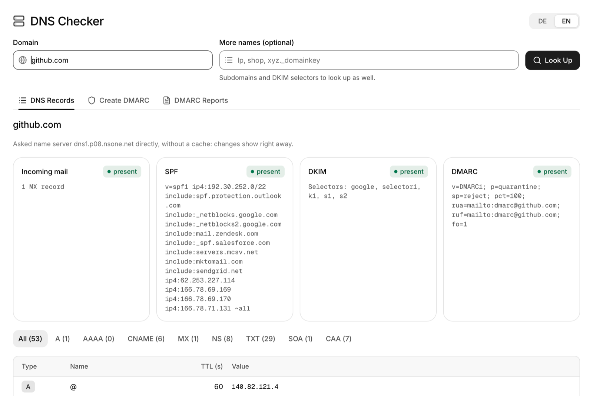
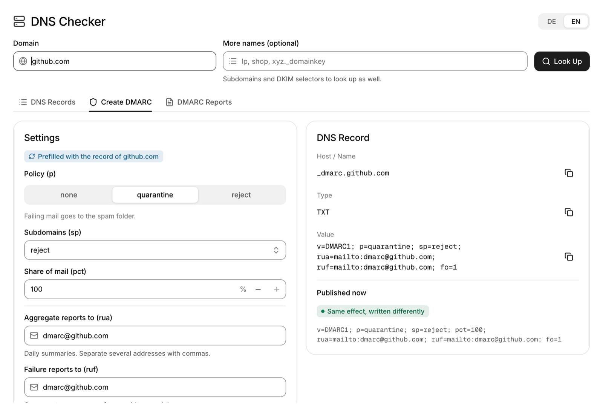
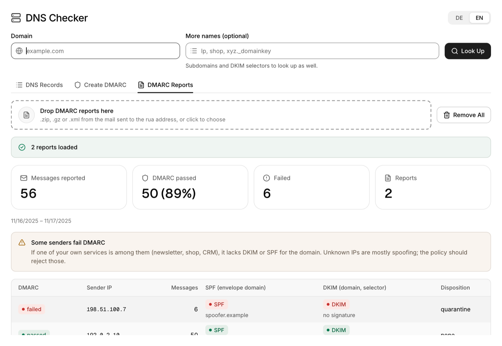

# DNS Checker

A small desktop app in C, built with [CUI](https://github.com/yappologistic/CUI), that looks up a
domain's DNS records, builds DMARC records and reads DMARC reports.



The window speaks German and US English; it starts in the system's language and switches with
the DE / EN control at the top right.

## Download

The [latest release](https://github.com/marchildmann/DNSChecker/releases/latest) has:

- **macOS 11 or later** (Apple silicon and Intel): `DNSChecker-<version>-macOS.dmg`, signed with a
  Developer ID and notarized by Apple. Open it and drag DNS Checker to Applications.
- **Windows 10 or later** (64-bit): `DNSChecker-<version>-Windows-x64.zip`. Unpack it and start
  `DNSChecker.exe`. It is not signed with a Windows certificate, so SmartScreen may ask once.

- **DNS Records:** queries A, AAAA, CNAME, MX, NS, TXT, SOA and CAA of the domain through the
  zone's own name server (libresolv, on a worker thread), so changes show at once instead of
  after the cached TTL; without a reachable server it falls back to the system resolver. Also
  asks `www`, common DKIM selectors (Google, Microsoft 365, Mailchimp, SendGrid, `default`,
  and dated ones like `default<YYMM>` when names exist below `_domainkey`) and the names typed
  under "More names". DNS cannot list a zone's names, so other subdomains have to be named.
  Shows everything in a table filtered by type, names relative to the domain (`@`, `www`), and
  summarizes mail authentication (MX, SPF, DKIM, DMARC).
- **Create DMARC:** builds the `_dmarc` TXT record from policy, subdomain policy, percentage,
  report addresses and alignment, with copy buttons, hints for missing or external report
  addresses, and a comparison with the record the domain publishes today. After a lookup the
  form starts from the published record, so editing it cannot silently weaken the policy.
- **DMARC Reports:** takes the aggregate reports receivers mail to the rua address (`.zip`,
  `.gz` or `.xml`, dropped on the window or picked in a dialog), merges them per sender and
  shows how many messages passed SPF, DKIM and DMARC, failing senders first. Nothing leaves
  the machine.

| Create DMARC | DMARC reports |
|---|---|
|  |  |

## Build and run

Needs CMake and a C compiler. On macOS everything else ships with the system (libxml2, zlib,
libresolv). On Windows, build in an [MSYS2](https://www.msys2.org) UCRT64 shell with
`pacman -S mingw-w64-ucrt-x86_64-{gcc,cmake,ninja,libxml2,zlib} git zip`.

```sh
cmake -S . -B build -DCMAKE_BUILD_TYPE=Release   # CUI: -DCUI_DIR=<checkout>, else fetched from GitHub
cmake --build build -j8
ctest --test-dir build --output-on-failure      # unit tests, no network
build/test_network                              # a real lookup of github.com

open "build/DNS Checker.app"                                       # macOS
"build/DNS Checker.app/Contents/MacOS/DNS Checker" example.com lp  # macOS, with a domain
build/DNSChecker.exe example.com                                   # Windows
```

## Releases

Pushing a tag such as `v1.0.0` runs [`.github/workflows/release.yml`](.github/workflows/release.yml):
it builds both systems, signs and notarizes the macOS app with
[`packaging/macos/sign_and_package.sh`](packaging/macos/sign_and_package.sh), packs the Windows
program with its DLLs ([`packaging/windows/package.sh`](packaging/windows/package.sh)) and publishes
the release with checksums. The signing secrets it needs are listed at the top of the workflow;
without them a tag fails rather than publish an unsigned app.

## Layout

| File | Job |
|---|---|
| `src/dns_lookup.c` | record types, names, record data as text, domain input normalization |
| `src/dns_query_resolv.c`, `src/dns_query_windows.c` | the query itself: libresolv on macOS, the DNS API on Windows |
| `src/portable.c` | the few calls that differ on Windows (local time, UTF-8 file names) |
| `src/domain_scan.c` | which names are asked, the queries, the mail authentication summary |
| `src/lookup_task.c` | the worker thread that runs a scan |
| `src/dmarc.c` | DMARC record builder and parser, report address checks |
| `src/report_file.c` | report files: zip, gzip or plain XML (zlib) |
| `src/dmarc_report.c` | aggregate report XML (libxml2), merging rows per sender |
| `src/main.c` | window, domain field, page switch |
| `src/page_records.c`, `src/page_dmarc.c`, `src/page_reports.c` | the three pages |
| `src/ui_text.c` | every text in German and US English, the system language |
| `tests/test_core.c`, `tests/fixtures/` | tests for domain names, DMARC records, reports and the texts of both languages (no network) |
| `tests/test_network.c` | a real lookup of github.com, run by CI on each system |
| `packaging/`, `.github/workflows/` | app bundle, signing, Windows package; CI and releases |
| `assets/icon/` | the app icon: `.icns`, `.ico` and its SVG sources |

## License

MIT, see [LICENSE](LICENSE). CUI is MIT licensed as well.
